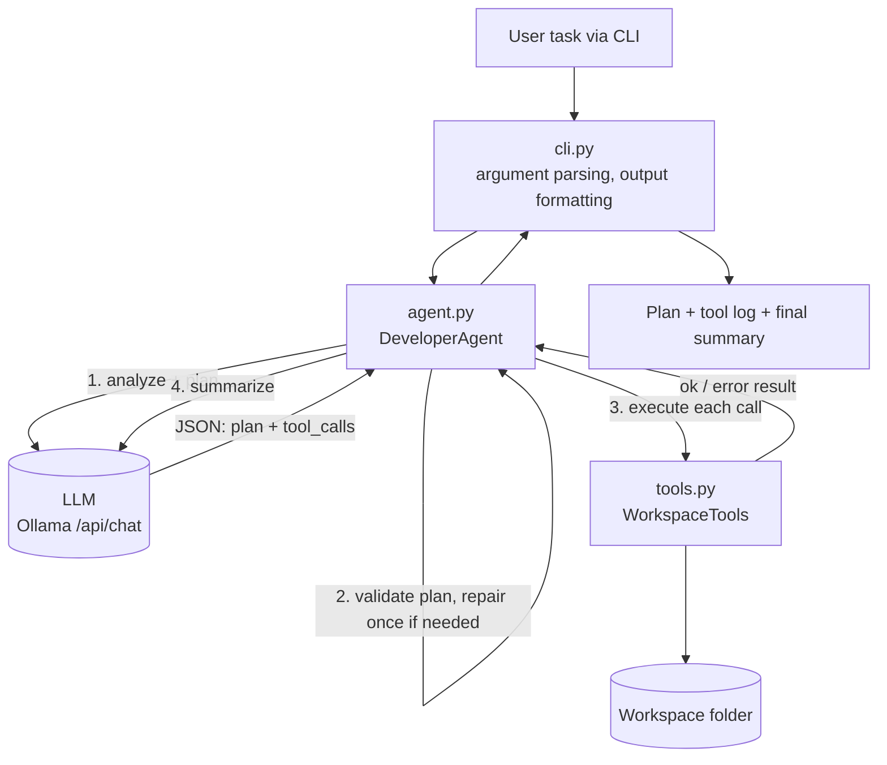

# AI Developer Agent

A small, local-first AI developer agent written in Python. You give it a development task in plain English. It analyzes the request, produces a short implementation plan, calls safe tools to carry the plan out, and prints every tool call and its result.

It uses a **local LLM through Ollama** (default model `qwen2.5:1.5b`), so no paid API key is needed. It uses only the Python standard library, so there is nothing to `pip install`.

> Standalone technical assessment project. It contains no client, employer or confidential material.

---

## Features

- **Request analysis and plan**: the LLM returns a short plan plus an ordered list of tool calls as JSON.
- **Five workspace-limited tools**: list, read, search, write and syntax-check.
- **Visible tool log**: every run prints the tool name, arguments, and a clear SUCCESS or ERROR result.
- **Plan validation**: unsafe parent-directory paths, missing required write/syntax-check steps, and `overwrite=true` without an explicit update request for that same file are caught before tools run. The model gets one correction attempt.
- **Graceful error handling**: Ollama not running, model not installed, timeouts, malformed JSON, unknown tools, bad arguments and blocked paths are all reported cleanly, without a crash.
- **Safety by design**: no shell access and no execution of generated code (see [Safety](#safety)).
- **Offline demo mode** (`--demo`): a deterministic mock that checks the tool pipeline without any model.
- **13 automated test methods, including a dedicated overwrite-intent regression test** using the standard `unittest` module.

---

## Requirements

- Python **3.10 or newer** (check with `python --version`)
- [Ollama](https://ollama.com/download) installed and running (only for live mode)
- About 1-2 GB of free disk space for the small model

---

## Setup

### 1. Get the code

```bash
git clone https://github.com/mohibbhattiai-droid/ai-developer-agent.git
cd ai-developer-agent
```

### 2. Install Ollama and pull the model (live mode)

1. Install Ollama from <https://ollama.com/download> and make sure it is running.
2. Download the default model:

```bash
ollama pull qwen2.5:1.5b
```

### 3. Dependencies

None. `requirements.txt` only notes that the project uses the standard library. Using a virtual environment is optional.

---

## How to run

### Live mode (real local LLM)

```bash
python main.py --task "Create greeting.py with a greet(name) function that returns Hello followed by the person's name. Then check its Python syntax."
```

If you leave out `--task`, the program asks you to type one.

By default the agent works inside a folder called `workspace/` (created automatically). Use `--workspace` to point it at another folder.

### Offline demo (no LLM, tool pipeline check only)

```bash
python main.py --demo
```

This uses a **mock** client, not a real model. It proves the tool pipeline works. It does **not** prove live LLM behavior. Each demo run writes to a fresh folder under `demo_workspace/`.

### Run the tests

```bash
python -m unittest discover -s tests -v
```

### Command-line options

| Option | Default | Description |
|---|---|---|
| `--task` | prompt | Natural-language development task |
| `--workspace` | `workspace` | The only folder the agent may read or write |
| `--model` | `qwen2.5:1.5b` | Installed Ollama model (also reads `OLLAMA_MODEL`) |
| `--host` | `http://localhost:11434` | Ollama API URL (also reads `OLLAMA_HOST`) |
| `--demo` | off | Run the fixed offline smoke test |

### Example tasks

1. `Create a Python module called greeting.py with a greet(name) function, then check its syntax.`
2. `List project files and search for TODO comments.`
3. `Read greeting.py and explain what it does.`
4. `Create a README.md for the current project that explains its purpose.`
5. `Update greeting.py to include a docstring and check syntax.`

More in [`examples/sample_tasks.md`](examples/sample_tasks.md).

---

## Example output

```
AI DEVELOPER AGENT - LIVE LOCAL LLM MODE
Model: qwen2.5:1.5b | Ollama: http://localhost:11434
Task: Create live_demo.py containing a greet(name) function ...

IMPLEMENTATION PLAN
  1. list_files
  2. write_file
  3. check_python_syntax

TOOL EXECUTION LOG

[1] TOOL CALL: list_files
    Arguments: { "path": "." }
    RESULT: SUCCESS

[2] TOOL CALL: write_file
    Arguments: { "path": "live_demo.py", "overwrite": true,
                 "content": "<file content: 44 characters; omitted from log>" }
    RESULT: SUCCESS
      { "path": "live_demo.py", "action": "created", "bytes_written": 44 }

[3] TOOL CALL: check_python_syntax
    Arguments: { "path": "live_demo.py" }
    RESULT: SUCCESS
      { "valid": true, "message": "Python syntax is valid. File was parsed but not executed." }

FINAL SUMMARY
...
```

---

## Screenshots

| Screenshot | What it shows |
|---|---|
| [Live Ollama run](screenshots/live_ollama_run.png) | A recorded real run with the local model: plan, three tool calls, results. **Recapture this screenshot after the latest overwrite-intent guard change before final submission.** |

---

## Architecture



### Flow of a run

1. **Analyze and plan**: the task and the tool catalogue are sent to the LLM, which must reply with one JSON object: `{"plan": [...], "tool_calls": [...]}`.
2. **Validate**: `_plan_issues()` checks for unsafe paths, a missing `write_file` for creation tasks, and a missing syntax check. If something is wrong, the model gets one chance to correct its plan before anything runs.
3. **Execute**: each tool call runs in order through `WorkspaceTools.execute()`, which never raises. It returns `{"ok": true, "result": ...}` or `{"ok": false, "error": ...}`. At most 6 tool calls are run.
4. **Summarize**: if any tool failed, or planning failed, the program reports that itself and does not let the model claim success. Otherwise the LLM writes a short summary.
5. **Report**: the CLI prints the plan, each tool call with arguments and result, and the summary. The exit code is non-zero if anything failed.

### Project structure

```
ai-developer-agent/
├── main.py                 # entry point
├── ai_dev_agent/
│   ├── cli.py              # CLI, argument parsing, console output
│   ├── agent.py            # Ollama client, prompts, plan validation, orchestration
│   ├── tools.py            # the five tools and path safety
│   └── demo.py             # deterministic mock client for --demo
├── tests/                  # unittest tests for tools and agent
├── examples/               # sample tasks and recorded outputs
├── screenshots/            # evidence of working runs
├── IMPLEMENTATION_NOTE.md  # what I built, AI tools used, limitations
└── requirements.txt
```

### Tools

| Tool | Purpose |
|---|---|
| `list_files` | List files under a directory in the workspace |
| `read_file` | Read a UTF-8 text file (size limited) |
| `search_files` | Case-insensitive text search across supported text files |
| `write_file` | Create a file. Overwriting an existing file requires `overwrite=true` |
| `check_python_syntax` | Parse a `.py` file with `ast.parse`. It does **not** run the code |

---

## Error handling

| Situation | Behavior |
|---|---|
| Ollama not running | Clear message telling you to start Ollama and pull the model |
| Model not installed (HTTP 404) | Message with the `ollama pull <model>` command |
| Request timeout | Message suggesting a retry or a smaller model |
| Model returns malformed JSON | Planning error is reported; only a harmless `list_files` runs |
| Model plans an unsafe path, omits a needed step, or requests an unapproved overwrite | One correction attempt, then a clear error without applying the unsafe write |
| Unknown tool, bad arguments | Returned as a tool ERROR, and the run continues |
| Empty or over-long task | Rejected with a clear message |
| Any tool failure | The summary says the task was incomplete instead of claiming success |

---

## Safety

- **Workspace sandbox**: all paths must be relative. Absolute paths, `..` traversal, and paths that resolve outside the workspace are rejected. Symlinks are not followed.
- **Secret protection**: `.env` files, private keys, `.ssh`, `.aws` and similar paths cannot be read, written or listed.
- **No shell, no code execution**: the agent cannot run commands or execute generated code.
- **Overwrite protection**: existing files are only replaced when `overwrite=true` is explicitly set, and the plan validator checks that the task explicitly requests updating that same file.
- **Size limits**: reads, writes and searches are bounded.

---

## Limitations

- **Single-pass planning.** The agent makes one plan and then runs the tools. It does not read tool results and re-plan, so it is not a full iterative agent loop.
- **Small-model quality.** `qwen2.5:1.5b` is small. It can write weak plans, choose the wrong tool, or write a summary that overstates what happened. The program overrides the summary when a tool fails, but it cannot catch every inaccurate claim.
- **Syntax is not correctness.** `check_python_syntax` only checks that code parses. It does not run it or test its behavior.
- **No shell or test-running tool**, by design.
- **Prototype scope.** This is an assessment project, not a production autonomous software engineer. Review generated files before using them elsewhere.

---

## AI use

This project was built with AI assistance (ChatGPT for design, code drafting, review and documentation). See [`IMPLEMENTATION_NOTE.md`](IMPLEMENTATION_NOTE.md) for what I implemented and tested myself, which tools I used, and further limitations.
