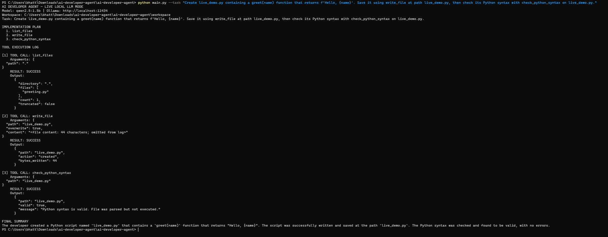

# AI Developer Agent

[](https://github.com/mohibbhattiai-droid/ai-developer-agent/actions/workflows/python-tests.yml)

A small, local-first Python agent that takes a development task in natural language, asks a local LLM for a short plan and tool calls, executes the selected tools inside a restricted workspace, and shows each tool call and its result.

Live inference uses **Ollama** (default model: `qwen2.5:1.5b`). No paid API key or third-party Python package is required.

## Features

- Analyzes a task and returns a short implementation plan.
- Uses a local LLM through Ollama's `/api/chat` endpoint.
- Provides five tools: list files, read a file, search text files, write a file, and check Python syntax.
- Prints each tool name, arguments, and success/error result.
- Handles unavailable models, connection errors, invalid plans, unsafe paths, and tool failures.
- Restricts file access to a chosen workspace; protects likely secret files and refuses implicit overwrites.
- Includes a deterministic offline demo and 13 automated unit tests.

## Requirements and setup

- Python 3.10+
- [Ollama](https://ollama.com/download) for live mode

```bash
git clone https://github.com/mohibbhattiai-droid/ai-developer-agent.git
cd ai-developer-agent
ollama pull qwen2.5:1.5b
```

Make sure Ollama is running. There are no Python dependencies to install because the project uses the standard library.

## Run it

**Live mode (real local LLM):**

```bash
python main.py --task "Create greeting.py with a greet(name) function and check its Python syntax."
```

**Offline smoke test (mock LLM, no Ollama required):**

```bash
python main.py --demo
```

**Run tests:**

```bash
python -m unittest discover -s tests -v
```

The CI workflow runs the unit tests and offline demo on Python 3.10, 3.11, and 3.12. See [the latest workflow runs](https://github.com/mohibbhattiai-droid/ai-developer-agent/actions).

Options: `--workspace` selects the workspace directory; `--model` selects the Ollama model; `--host` sets the Ollama API host. Run `python main.py --help` for details.

## Architecture

1. **CLI (`main.py`, `ai_dev_agent/cli.py`)** collects the task and prints the plan, tool log, and summary.
2. **Agent (`ai_dev_agent/agent.py`)** asks Ollama for a JSON plan, checks common plan issues, and orchestrates tool calls.
3. **Tool layer (`ai_dev_agent/tools.py`)** validates paths and runs only allowlisted file operations.
4. **Demo (`ai_dev_agent/demo.py`)** supplies a fixed mock response for offline smoke testing.

## Tools

| Tool | Purpose |
|---|---|
| `list_files` | List files inside the workspace |
| `read_file` | Read a UTF-8 text file |
| `search_files` | Search supported text files for a phrase |
| `write_file` | Create or explicitly approved update of a file |
| `check_python_syntax` | Parse a Python file with `ast.parse`; never executes it |

## Screenshots and evidence



This image records a live local Ollama run, but it predates the latest overwrite-intent guard. The current revision's unit tests and offline demo pass in [GitHub Actions](https://github.com/mohibbhattiai-droid/ai-developer-agent/actions/runs/38979797775). For a fully synchronized submission, capture a new live-mode screenshot after running the command above on the final revision. The offline demo is clearly labelled as a mock and must not be described as live LLM inference.

See [`IMPLEMENTATION_NOTE.md`](IMPLEMENTATION_NOTE.md) for the contribution, AI-use, and limitations note. See [`examples/sample_tasks.md`](examples/sample_tasks.md) for sample tasks.

## Safety and limitations

- All file tools are restricted to the selected workspace. Absolute paths, parent-directory traversal, symlinks, and likely credential files are blocked.
- The agent does not provide shell access or execute generated code.
- Planning is single-pass; it does not iteratively re-plan after reading tool results.
- Syntax checking proves only that Python parses, not that a program behaves correctly.
- Output quality depends on the chosen local model. Review generated files before using them in a real project.
